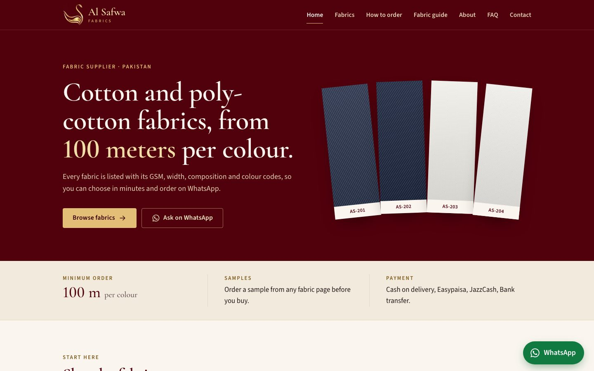
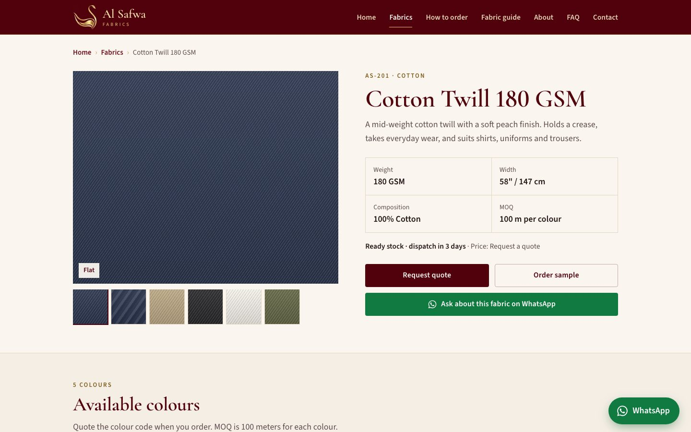
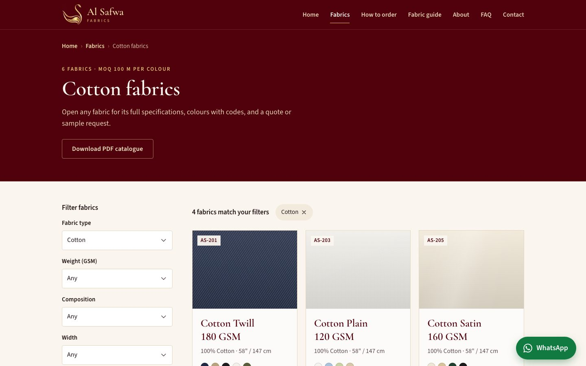
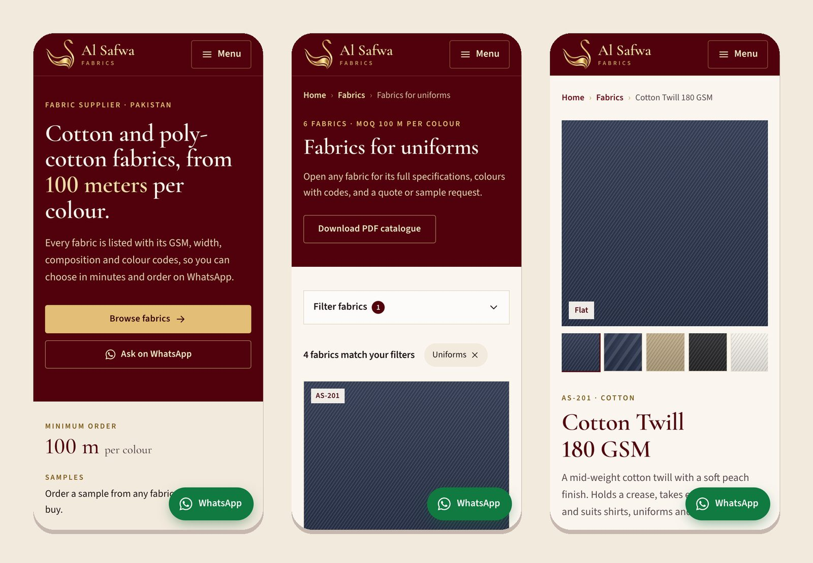
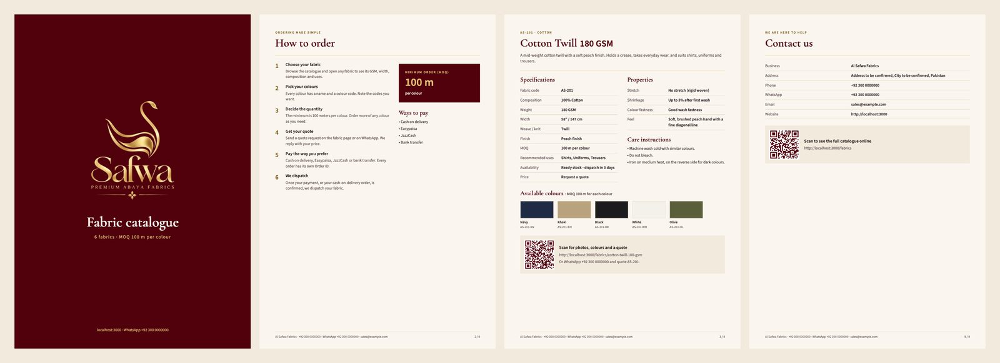
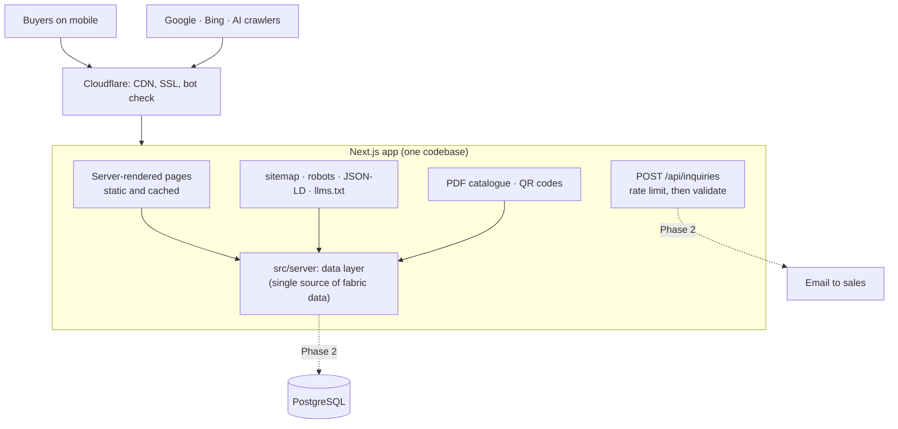

<div align="center">


# Al Safwa Fabrics

**A mobile-first B2B catalogue and inquiry website for a fabric supplier in Pakistan.**
Buyers see every fabric's GSM, width, composition, colour codes and MOQ in seconds, then ask for a quote or a sample on WhatsApp.


<br />



</div>

---

## Contents

- [The problem](#the-problem)
- [What I built](#what-i-built)
- [Screenshots](#screenshots)
- [Tech stack](#tech-stack)
- [Architecture](#architecture)
- [Quality: testing, accessibility, performance, security](#quality)
- [Engineering decisions worth noting](#engineering-decisions-worth-noting)
- [Project structure](#project-structure)
- [Getting started](#getting-started)
- [Process and documentation](#process-and-documentation)
- [Roadmap](#roadmap)
- [Author](#author)

---

## The problem

Fabric buyers in Pakistan (tailors, garment makers, uniform suppliers) mostly shop from their phones and mostly order on WhatsApp. Before buying, every buyer asks the same questions: *What's the GSM? How wide is it? Which colours do you have? What's the minimum order?* The supplier answers them by hand, one chat at a time.

The brief was a site that works as a **24/7 salesperson**:

- every fabric gets its own page with complete, exact details;
- the MOQ (100 m per colour) and the way to order are obvious within seconds on a phone;
- it ranks on Google and gets recommended by AI assistants;
- it looks premium, yet stays simple enough for any buyer, of any age.

## What I built

| Area | Highlights |
|---|---|
| **Catalogue** | 6 combinable filters (type, GSM, composition, width, colour, use) that **work without JavaScript** (plain GET form, shareable URLs). Category pages for each fabric type and each use, each with its own H1, title and canonical. |
| **Fabric pages** | Every spec as real, crawlable text. A swipeable gallery with woven-texture swatches drawn in CSS for each colour until real photos arrive, and colour codes. "Request quote" and "Order sample" buttons switch one form between modes. Related fabrics and guides. |
| **Ordering** | Floating WhatsApp button on every page with a **pre-filled message naming the fabric**. Quote, sample and contact forms validated with one shared schema in the browser and on the server. |
| **PDF catalogue + QR codes** | A 9-page branded A4 catalogue generated from the same data as the site (`@react-pdf/renderer`), with a **QR code per fabric** linking to its page. Rendered once and served from cache. |
| **SEO and AI search** | Unique metadata per page, XML sitemap, robots.txt, JSON-LD (Organization, LocalBusiness, Product, FAQPage), and an `llms.txt` summary for AI assistants. |
| **Navigation** | Breadcrumbs on every inner page and a sticky header. The phone menu is built on `<details>`, so it opens without JavaScript. Any fabric is at most 2 taps from Home, and an automated test checks that. |
| **Brand** | A design system taken from the client's logo: maroon and gold tokens with WCAG-checked contrast, Cormorant Garamond with Source Sans 3, and a gold-rule ornament from the logo. Logo assets were cut out of the master logo by shape. |

## Screenshots

<table>
  <tr>
    <td width="50%"></td>
    <td width="50%"></td>
  </tr>
  <tr>
    <td align="center"><sub><b>Fabric page</b>: key facts, colours, quote and sample actions</sub></td>
    <td align="center"><sub><b>Catalogue</b>: category page with six filters</sub></td>
  </tr>
</table>


<p align="center"><sub><b>Designed at 360 px first</b>: home, category and fabric pages on a phone</sub></p>


<p align="center"><sub><b>Generated PDF catalogue</b>: cover, how to order, a fabric page with its QR code, contact</sub></p>

## Tech stack

| Layer | Technology |
|---|---|
| Framework | **Next.js 16** (App Router, Cache Components, Partial Prefetching) · **React 19** |
| Language | **TypeScript** (strict) |
| Styling | **Tailwind CSS 4** with design tokens in `globals.css` · `next/font` (self-hosted) |
| Validation | **Zod 4**: one schema shared by the form and the API |
| Documents | `@react-pdf/renderer` (PDF catalogue) · `qrcode` (QR codes) |
| Testing | **Vitest** + Testing Library · **Playwright** (phone + desktop) · **axe-core** · Lighthouse |
| Planned (Phase 2–3) | PostgreSQL + Prisma, Auth.js, Cloudflare R2, Resend/Brevo, Turnstile, Docker on a VPS behind Cloudflare |

## Architecture

One Next.js codebase serves the public site and (in Phase 2) the owner's admin and API.



**One source of truth.** Pages, the sitemap, `llms.txt`, the PDF and the QR codes all read fabrics through `src/server/`. In Phase 2 that layer switches from typed content files to PostgreSQL, and no page has to change.

## Quality

### Testing: 271 automated tests

| Suite | Count | What it proves |
|---|---|---|
| Unit + component (Vitest) | **70** | Filters, validation, SEO text, JSON-LD, request parsing, rate limiter, security headers, QR codes, the inquiry form's states |
| Browser (Playwright) | **201** | Every page and buyer journey at **360 px and desktop**; pages readable **with JavaScript off**; axe accessibility checks; sitemap, robots and schema; attack tests against the API |

Test names carry PRD requirement IDs (e.g. `(FR-07)`), so each requirement maps to the test that proves it.

### Lighthouse (mobile)

| Page | Performance | Accessibility | Best practices | SEO |
|---|---|---|---|---|
| Home | 99 | 100 | 100 | 100 |
| Catalogue | 99 | 100 | 100 | 100 |
| Fabric page | 99 | 100 | 100 | 100 |
| FAQ / Guides / About | 99 | 100 | 100 | 100 |
| Contact | 96 | 100 | 100 | 100 |

Every page renders with no layout shift (CLS 0). Contact is a little slower because of the embedded Google Map.

### Security

The public API was tested from an attacker's point of view:

- **Request checks:** wrong methods, form-encoded bodies (CSRF-style simple requests), malformed JSON, oversized and streamed bodies, and lying `Content-Length` headers.
- **Payload checks:** mass assignment, prototype pollution, type confusion, and injection payloads.
- **Rate limiting:** the 11th submission from one client gets `429` with `Retry-After`.
- **Response hardening:** a strict Content-Security-Policy with no third-party origins unless analytics is switched on, plus HSTS, `nosniff` and `frame-ancestors 'none'`.
- **Guardrails:** an automated test fails if any page triggers a CSP violation.
- **Dependencies:** `npm audit` reports 0 vulnerabilities.

## Engineering decisions worth noting

Each of these came from a test or a review, and is documented in the [test report](docs/reports/phase-1/03_TEST_REPORT.md).

- **Real 404s under Partial Prefetching.** Unknown fabric URLs first returned `200` (a "soft 404" that hurts SEO), because the app shell streamed before `notFound()` ran. `ensureStatic = "navigation"` makes them wait for the full render and return a true `404`.
- **No duplicate markup from Suspense.** A pathname-aware WhatsApp button made the server send the button twice. It became a plain server component, and one CSS `:has()` rule hides the general button when a fabric page renders its own.
- **CSP-safe validation.** Zod probes `eval` in the browser. The probe is harmless, but it raised a CSP violation, so the app runs Zod in `jitless` mode. A test was mutation-checked to make sure it catches that violation.
- **PDF as a static asset.** The PDF route first rendered on every request, which was CPU-heavy and could be abused. It is now cached, so the build produces a static file.
- **Rate-limit design.** Limits are kept in memory with a bounded store, using a configurable trusted client-IP header (`cf-connecting-ip` behind Cloudflare). Tests give every attack its own client so the limiter never masks a result.

## Project structure

```
Safwa_Website/
├── docs/                         PRD, brand + SEO guides, plan, checklist, reports, screenshots
└── web/                          The Next.js application
    ├── src/
    │   ├── app/                  Routes: (site)/ public pages, api/, sitemap, robots, llms.txt, PDF
    │   ├── components/           UI: layout, fabric, forms, seo, analytics, ui primitives
    │   ├── server/               Server-only: catalogue data, filters, inquiries, PDF + QR, rate limiting
    │   ├── content/              Phase-1 content (moves to PostgreSQL in Phase 2)
    │   ├── config/               Site settings (NAP), security headers, analytics switches
    │   ├── lib/                  Shared helpers: validation, SEO builders, formatting, WhatsApp links
    │   └── types/                Domain types mirroring the PRD's catalogue fields
    └── tests/                    unit/ · e2e/ · security/ · support/
```

## Getting started

Requires **Node.js 20.9+**.

```bash
git clone https://github.com/SirajMunir10/Safwa_Website.git
cd Safwa_Website/web
npm install

npm run dev                       # http://localhost:3000
npm run build && npm start        # production build
```

| Command | Purpose |
|---|---|
| `npm test` | Unit and component tests |
| `npx playwright install chromium` | One-time browser download for E2E tests |
| `npm run test:e2e` | Browser tests against the production build (run `npm run build` first) |
| `npm run test:all` | Lint, type-check, unit, build and browser tests in one go |

<details>
<summary><b>Environment variables</b> (all optional for local development)</summary>

| Variable | Purpose |
|---|---|
| `NEXT_PUBLIC_SITE_URL` | Canonical domain for URLs in the sitemap, structured data, `llms.txt`, PDF and QR codes |
| `NEXT_PUBLIC_GA_MEASUREMENT_ID` | Turns on Google Analytics 4 (and opens its CSP origins) |
| `GOOGLE_SITE_VERIFICATION` · `BING_SITE_VERIFICATION` | Search Console / Bing Webmaster verification tags |
| `CLIENT_IP_HEADER` | Header used for rate limiting (`cf-connecting-ip` behind Cloudflare) |

</details>

## Process and documentation

The project follows a written lifecycle, with the client's approval required between phases:

`PLAN → IMPLEMENT → ENGINEERING TESTS → UPDATE CHECKLIST → REPORT → STOP → USER TESTS → USER APPROVES → NEXT PHASE`

| Document | What it covers |
|---|---|
| [PRD](docs/prd/PRD.md) | Scope of record |
| [Implementation plan](docs/plan/IMPLEMENTATION_PLAN.md) | Lifecycle rule, phases, open questions, change log |
| [Implementation checklist](docs/plan/IMPLEMENTATION_CHECKLIST.md) | Status and client approval for every requirement |
| [Brand guidelines](docs/brand/BRAND_GUIDELINES.md) | Palette with contrast ratios, typography, components |
| [SEO and AI-search guide](docs/seo/SEO_GEO_GUIDELINES.md) | Every SEO rule mapped to its code |
| [Test strategy](docs/testing/TEST_STRATEGY.md) · [Test report](docs/reports/phase-1/03_TEST_REPORT.md) | How it's tested, and the results |
| [Phase reports](docs/reports/) | Pre- and post-implementation reports for each iteration |

## Roadmap

| Phase | Scope | Status |
|---|---|---|
| **1** | Public website, SEO/GEO, PDF + QR, test suite | ✅ Built and engineering-tested; in client review |
| **2** | PostgreSQL, owner admin (fabrics, blog, FAQ, inquiries, settings), saved and emailed inquiries, orders with manual payments (COD, Easypaisa, JazzCash, bank transfer) | Planned |
| **3** | Security test round 2, Docker on a VPS behind Cloudflare, analytics, backups, launch | Planned |

> **Note:** business details (address, phone, email) and the starter fabric data are placeholders until the client supplies the real ones.

## Author

**Siraj Munir**: design, full-stack development and testing

[](https://github.com/SirajMunir10)
